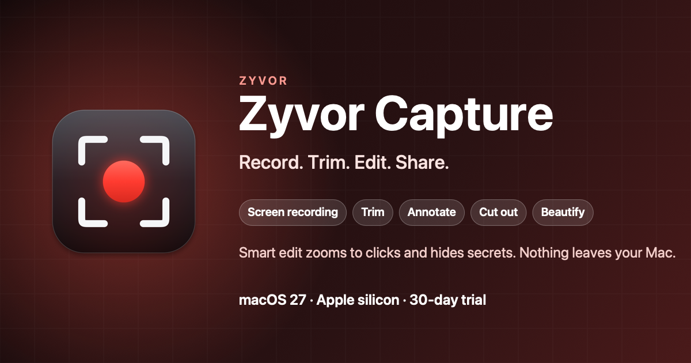

# Zyvor Capture

### Record. Trim. Edit. Share.

Record your screen, trim and tidy the video, and edit screenshots and photos, all in one native macOS 27 menu-bar app that never touches the network.

 

**[Download 0.2.0](https://github.com/zyvorai/capture/releases/tag/v0.2.0)** &nbsp;·&nbsp; [Ask for a 30-day trial](mailto:sales@zyvor.dev?subject=Zyvor%20Capture%20trial%20key) &nbsp;·&nbsp; [Website](https://zyvorai.github.io/capture/) &nbsp;·&nbsp; [Docs](docs/INSTALL.md) &nbsp;·&nbsp; [Prices](https://zyvor.dev/pricing)

`ZyvorCapture-0.2.0.dmg` · macOS 27 or later · Apple silicon · Developer ID signed and notarized

---

## Get it

| | |
| --- | --- |
| **Trial** | A free 30-day trial key: **sales@zyvor.dev**. You do not need a key to use the app. |
| **Download** | [Zyvor Capture 0.2.0](https://github.com/zyvorai/capture/releases/tag/v0.2.0): `ZyvorCapture-0.2.0.dmg` (SHA-256 `d26d0414a4bed5df34ff39ec46a8129b5d5f8b301acf0b0994b6ef5c13792bf4`) |
| **Requirements** | macOS 27 or later, Apple silicon |
| **Pricing** | See [zyvor.dev/pricing](https://zyvor.dev/pricing) or write to sales@zyvor.dev. |

## What it does

**Record.** A display, one window or an area, with optional system audio and microphone, a countdown and a hotkey (Control-Option-Command-V). Screenshots with Control-Option-Command-P, with an optional delay and copy to the clipboard.

**Trim and export.** Cut a recording to the part you want, or trim to where the action is, and export MP4 or an animated GIF at 1080p, 720p or 480p. Leave the sound out, export just the sound, or grab a frame into the photo editor.

**Smart edit** (for recordings made in the app, which save pointer positions beside the video):

- **Speed up idle time**, or cut it out, where the pointer neither moves nor clicks. Sped-up parts are silent.
- **Zoom in on clicks**, easing in and out, with optional click rings.
- **Spotlight the pointer**, frame the video with a background, rounded corners and shadow, fade in and out, and play it faster.
- **Hide sensitive text.** On-device text recognition finds emails, API keys, tokens, private-key headers and card numbers and pixelates them only while they are on screen. It is a helper, not a guarantee: check before you share.

**Photo editor.** Crop (including 1:1, 16:9, 4:3 and more), rotate, flip and straighten; exposure, contrast, saturation, sharpness, warmth, shadows, highlights, vignette and filters; arrows, shapes, text and numbered steps; blur, pixelate or cover to redact, or **find and hide secrets** automatically; copy the text in a picture or read a QR code; cut out the subject; beautify with a background, rounded corners, a shadow and an optional macOS window frame. Export PNG, JPEG or HEIC.

## Privacy and security

- **No network.** Zyvor Capture contains no networking code, and its one special entitlement is the microphone (`com.apple.security.device.audio-input`). Verify: `codesign -d --entitlements - "/Applications/Zyvor Capture.app"`. It is not sandboxed.
- Screen Recording is asked when you first record or take a screenshot; Microphone only if you turn it on.
- It does not log keystrokes. Pointer positions and clicks are saved only beside your recordings, and you can delete that file.

See [docs/PRIVACY.md](docs/PRIVACY.md).

## Limits

- Early release: beyond its automated tests, the real screen capture, the Screen Recording and Microphone prompts, audio, the smart edits on real recordings, VoiceOver and a clean-Mac install have not been tested by us.
- Removing objects from photos is not in this release.

## Trial and licence

30-day trial key: sales@zyvor.dev. Without a key, or after a trial, no data is lost and the app keeps working; a commercial license is required for production use. Licensed under the [Zyvor Production Licence v2.0](LICENSE); see [NOTICE](NOTICE) and [docs/LICENSING.md](docs/LICENSING.md).

**The Zyvor Capture source code is private.** This repository holds documentation and the website.

Copyright © 2026 Zyvor AI Labs Private Limited · [zyvor.dev](https://zyvor.dev)
